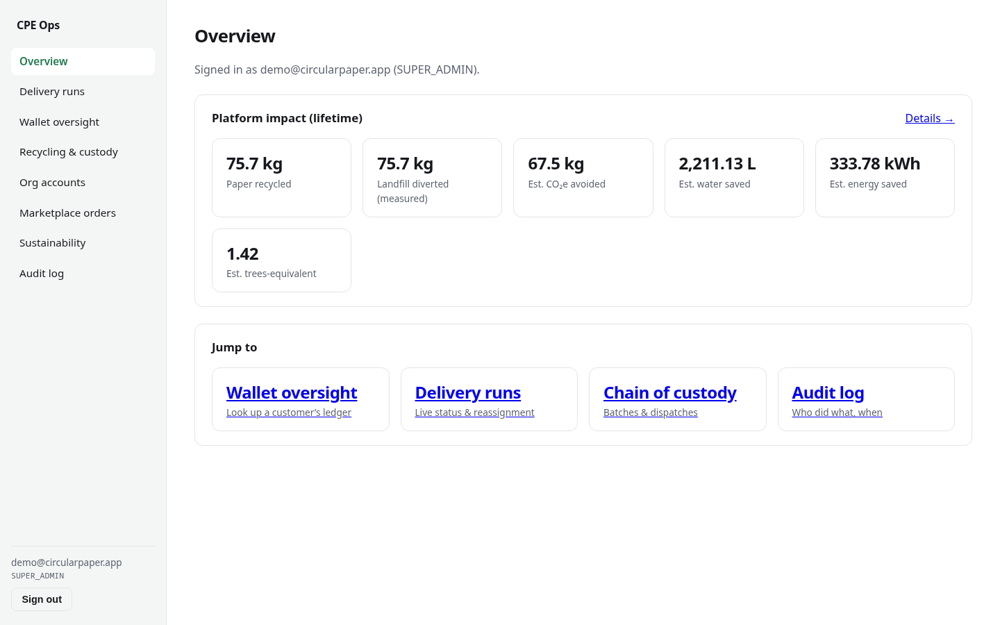
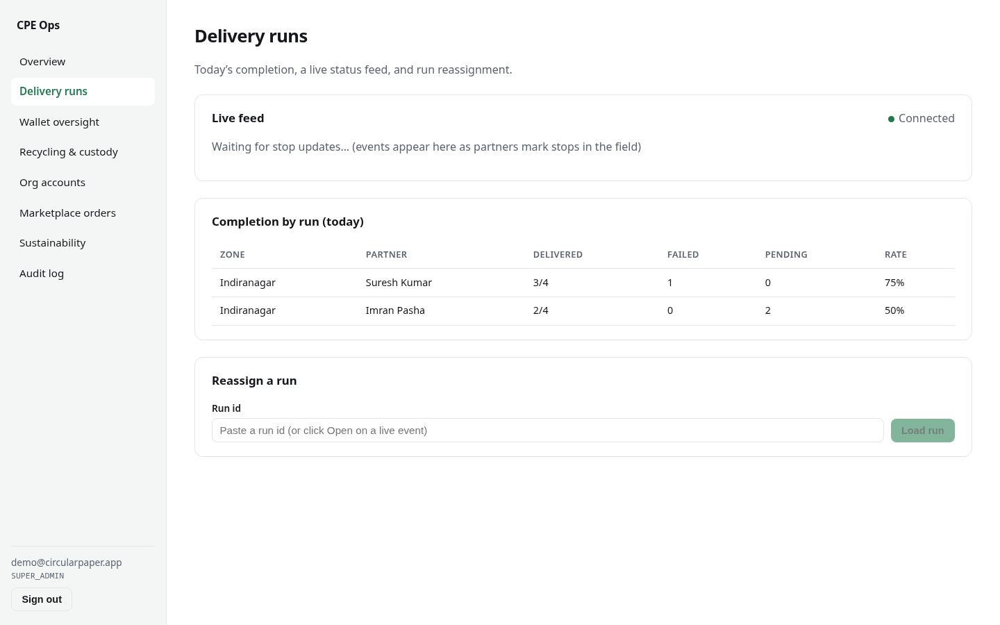
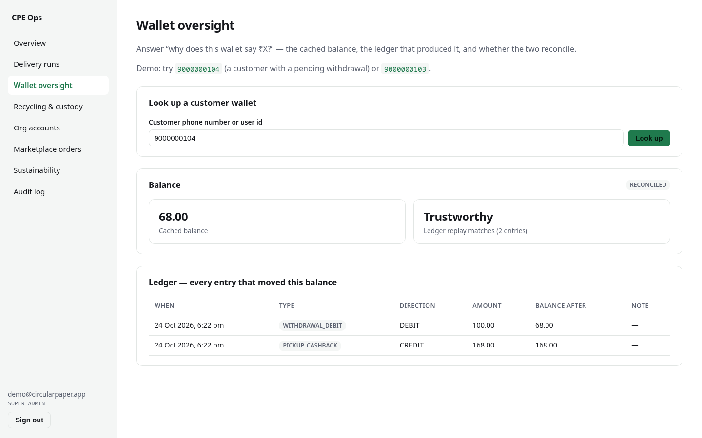
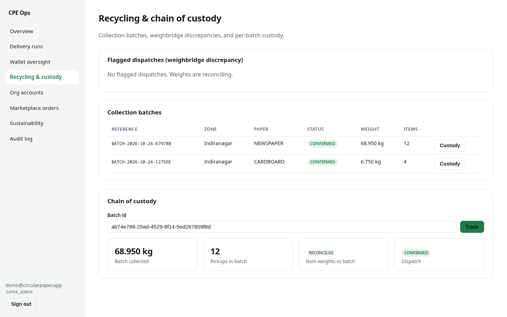
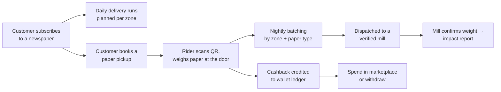
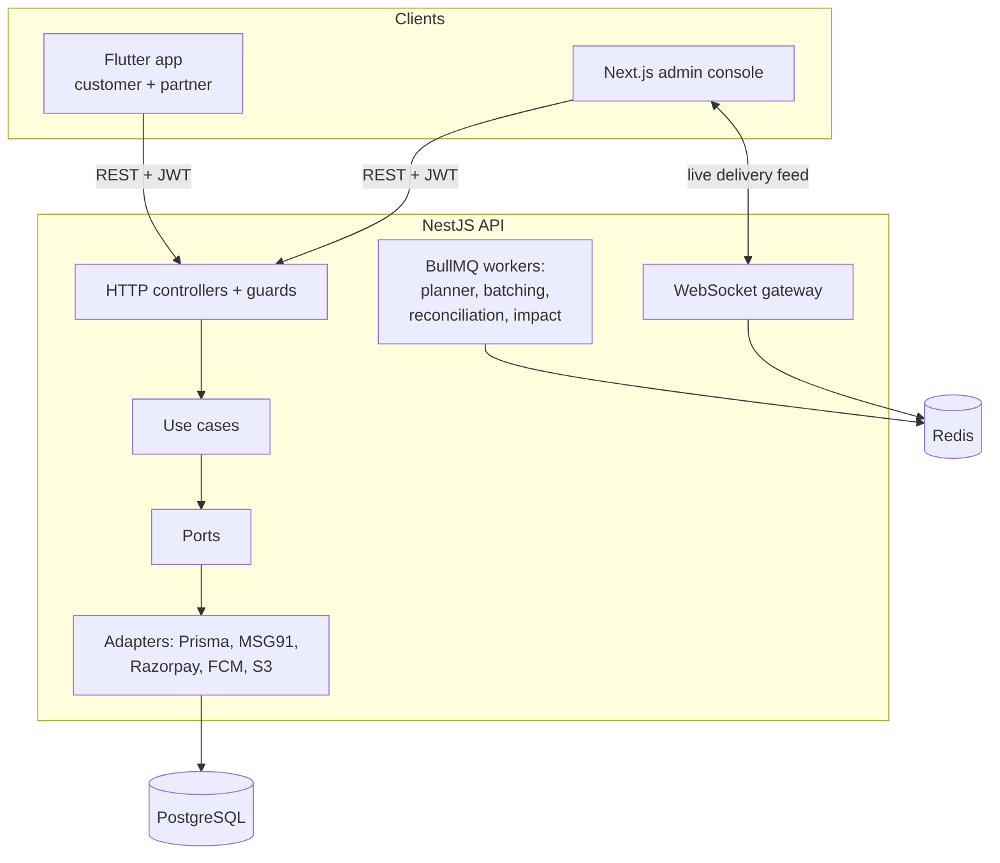

# Circular Paper Economy

**A full-stack platform that closes the loop on newspaper waste:** households subscribe to a
newspaper, a delivery partner picks up their old paper, weighs it at the door, and the customer is
paid cashback into a wallet. The paper is batched, sent to a verified recycling mill, and every
kilogram the mill confirms becomes a CO₂/water/energy impact figure. Customers can spend their
cashback on recycled-paper goods in a built-in marketplace.

[](https://github.com/PulipatiPranav/waste-management/actions/workflows/ci.yml)


### Live demo

| What               | Link                                                                                                    |
| ------------------ | ------------------------------------------------------------------------------------------------------- |
| Ops admin console  | **https://circular-paper-admin.onrender.com** — sign in with `demo@circularpaper.app` / `demo-password` |
| API docs (Swagger) | https://circular-paper-api.onrender.com/docs                                                            |

> Hosted on Render's free tier: the first request after a quiet spell takes **~30–60 s** while the
> server wakes up. The demo is seeded with sample customers, pickups and a recycled batch. Any
> phone number signs in to the API with OTP `000000` (demo mode only — refused in production).

---

## Screenshots

| Overview: platform impact                      | Delivery runs: today's completion               |
| ---------------------------------------------- | ----------------------------------------------- |
|      |  |
| **Wallet: balance, ledger and reconciliation** | **Recycling: batches and chain of custody**     |
|          |     |

---

## What it does



Four apps share one backend:

- **Customer app** (Flutter): subscribe, book pickups, show a QR code at the door, see wallet and
  personal impact, shop.
- **Delivery-partner app** (same Flutter app, role-based): today's route, QR scan and weighing,
  photo proof of delivery, and an **offline queue** so no field action is lost in a dead zone.
- **Ops admin console** (Next.js): live delivery feed over WebSockets, run reassignment, wallet
  oversight, recycling chain of custody, organisation accounts, marketplace sellers, audit log.
- **API** (NestJS): 14 feature modules, 120+ endpoints, background jobs, OpenAPI docs.

---

## Engineering highlights

Decisions worth reading the code for:

- **Money is an append-only ledger.** The wallet balance is a cache. Every credit and debit is a
  ledger row, a Postgres trigger blocks deletes, and a nightly job replays every wallet and alerts on
  any mismatch. The admin console shows the reconciliation next to the balance.
- **Idempotency on every money-moving endpoint.** Pickup completion and withdrawals require an
  `Idempotency-Key`, so a rider's flaky-network retry can never pay a customer twice.
- **Auth built to resist the usual attacks.** OTPs come from a CSPRNG and are stored hashed (Argon2),
  rate-limited per phone and per IP, and single-use. Refresh tokens rotate, and reusing a spent
  token revokes the whole token family (theft detection). Staff login spends the same time on a
  missing user as on a wrong password, so response timing can't reveal which emails exist.
- **Clean Architecture, enforced by lint.** Each module is split into domain, application,
  infrastructure and presentation layers. ESLint fails the build if domain code imports NestJS,
  Prisma or BullMQ, so the ledger and subscription state machine are unit-tested with no database.
- **Unsafe config refuses to boot.** A Zod schema validates every env var at startup and rejects
  the fake SMS, payment and push providers, local disk storage, Swagger, and demo mode in production.
- **Impact claims are kept modest.** Only mill-confirmed weight counts. CO₂ uses the EPA WARM factor
  and is labelled _estimated_, and the API never claims "carbon neutral".
- **Offline-first field app.** Delivery outcomes and weighings are written to a durable local queue
  (Drift/SQLite) first, deduplicated, and synced by a single-flight drain. A server `CONFLICT` on
  retry counts as success.
- **Production plumbing.** Structured JSON logs with correlation ids, OpenTelemetry traces,
  Prometheus metrics, Sentry; Kubernetes manifests with HPA, PDB and probes; CI/CD that builds
  immutable images, runs migrations as a separate gated step and holds production behind a manual
  approval. See the [runbook](docs/runbook.md).

### Tests

600+ automated tests, all passing:

| Suite                                          | Count |
| ---------------------------------------------- | ----: |
| API unit tests (Jest)                          |   390 |
| API end-to-end tests (real Postgres + Redis)   |   172 |
| Admin console tests (Vitest + Testing Library) |     7 |
| Flutter widget/unit tests                      |    37 |

CI runs lint (zero warnings), typecheck, build, unit tests, migrations and the e2e suite against
real Postgres and Redis service containers on every push, plus `flutter analyze` and `flutter test`.

---

## Tech stack

| Layer         | Technology                                                                                                |
| ------------- | --------------------------------------------------------------------------------------------------------- |
| API           | NestJS 11, TypeScript (strict), Prisma 6, PostgreSQL 17, Redis, BullMQ, Socket.IO                         |
| Admin console | Next.js 15 (App Router), React 19, TanStack Query                                                         |
| Mobile        | Flutter 3.44, Riverpod, GoRouter, Dio, Drift (SQLite), freezed                                            |
| Contracts     | OpenAPI → generated TypeScript types shared by API and admin (`packages/shared-types`)                    |
| Observability | pino JSON logs, OpenTelemetry, Prometheus, Sentry                                                         |
| Infra         | Docker, Kubernetes (Kustomize), GitHub Actions, Render (demo)                                             |
| Integrations  | MSG91 (SMS), Razorpay (payments), FCM/APNs (push), S3/R2 (photos), each behind a port with a fake for dev |



---

## Run it locally

Needs Node 22+, pnpm (`corepack enable`), and Docker or Podman.

```bash
pnpm install
pnpm dev:infra                                       # Postgres + Redis in containers
cp apps/api/.env.example apps/api/.env
cp apps/admin/.env.example apps/admin/.env.local
pnpm --filter @cpe/api exec prisma migrate deploy

# Optional: fill the database with the same sample data as the hosted demo
DEMO_MODE=true pnpm --filter @cpe/api seed:demo

pnpm --filter @cpe/api dev                           # http://localhost:3000/docs
pnpm --filter @cpe/admin dev                         # http://localhost:3001
```

Mobile: `cd apps/mobile && flutter pub get && dart run build_runner build && flutter run` (see
[apps/mobile/README.md](apps/mobile/README.md)).

Repo-wide checks: `pnpm lint`, `pnpm typecheck`, `pnpm test`, `pnpm --filter @cpe/api test:e2e`.

---

## Repository layout

```
apps/
  api/           NestJS backend: src/modules/<feature>/{domain,application,infrastructure,presentation}
  admin/         Next.js ops console
  mobile/        Flutter app (customer + delivery partner)
packages/
  shared-types/  TypeScript contracts generated from the API's OpenAPI spec
infra/
  docker/        docker-compose for local dev, production Dockerfiles
  k8s/           Kustomize base + staging/production overlays
  render/        Demo Dockerfiles used by render.yaml
docs/            Engineering notes, runbook, go-live roadmap, demo deploy guide
```

## Documentation

- [Engineering notes](docs/engineering-notes.md): the detailed design log, phase by phase, with
  the reasoning behind each decision and the known gaps.
- [Runbook](docs/runbook.md): deploy, roll back, check health, respond to alerts.
- [Production readiness](docs/phase-14-production-readiness.md): security review (OWASP API Top 10)
  and observability.
- [Deploying the demo](docs/deploy-demo.md): the Render setup behind the live demo.
- [Go-live roadmap](docs/go-live-roadmap.md) and [setup guide](docs/setup-guide.md): what it takes
  to launch for real (accounts, keys, app-store listings).

> **Regulatory note.** A withdrawable cashback wallet may count as a prepaid payment instrument
> under RBI rules. The code keeps payouts as manual, two-step staff actions so this can be decided
> by counsel before real money moves. Details in the
> [engineering notes](docs/engineering-notes.md#regulatory-the-wallet-is-not-a-licensed-instrument).

## License

[MIT](LICENSE)
